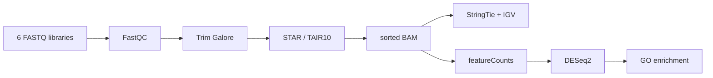

<div align="center">

<h1>From reads to regulation</h1>

<p><strong>An end-to-end RNA-seq analysis of iron-deficiency responses in <em>Arabidopsis thaliana</em></strong></p>

[](https://github.com/Ci-yo/BIO211_CW2_RNAseq/actions/workflows/archive-check.yml)


<sub>FastQC profiles before and after evidence-based read trimming.</sub>

</div>

## Step-by-step guide

Choose a route before installing the full environment:

| Route | Needed inputs | What you can do |
|---|---|---|
| A: inspect the published analysis | Only this repository and Python 3.10+ | Validate archived counts/results and read the six-sample comparison. |
| B: rerun GO enrichment | Included gene lists plus the R environment | Recalculate enrichment from the retained strict gene sets. |
| C: start from reads | The exact six teaching FASTQs and matching TAIR10 reference files, supplied separately | Align, quantify, run DESeq2 and optionally inspect transcript assemblies. |

### 1. Download and check the archive

In a **terminal** with [Git](https://git-scm.com/downloads) and
[Python](https://www.python.org/downloads/) installed:

```bash
git clone https://github.com/Ci-yo/BIO211_CW2_RNAseq.git
cd BIO211_CW2_RNAseq
python scripts/validate_archive.py
```

Start with [`data/results/deseq2_results_with_normalized_counts.tsv`](data/results/deseq2_results_with_normalized_counts.tsv)
and [`docs/analysis-notes.md`](docs/analysis-notes.md). The archive records
453 genes at FDR < 0.05 and 189 genes in the stricter GO input set.
This check requires no FASTQ files, R or aligner.

### 2. Set up the analysis environment

For routes B/C, use **Linux or WSL2 on Windows**, with Conda/Bioconda.
Run these commands in that Linux shell, not native PowerShell:

```bash
conda env create -f environment.yml
conda activate bio211-rnaseq
```

The environment includes command-line tools and the R/Bioconductor packages
used by the scripts. It specifies R 4.2 but is not an exact package lockfile.
For route B, the included gene lists are sufficient:

```bash
Rscript scripts/04_go_enrichment.R
```

Read `data/results/go_up_bp.tsv`, `go_down_bp.tsv` and the corresponding MF/CC
tables. Non-empty enrichments also produce `figures/differential-expression/go_*.png`.
Annotation-package changes can alter enrichment results.

### 3. Prepare the external inputs for a read-level rerun

For route C, create the directories:

```bash
mkdir -p data/raw reference
```

Place these files in them:

```text
data/raw/C1.fastq  C2.fastq  C3.fastq  T1.fastq  T2.fastq  T3.fastq
reference/TAIR10.toplevel.fa
reference/TAIR10.gtf
reference/TAIR10.chrom.sizes   # needed for the IGV/TDF assembly branch
```

The script expects six **uncompressed single-end** FASTQs: C1–C3 are controls;
T1–T3 are iron-deficiency samples. The exact teaching subset and its full
accession-to-file mapping are not distributed here. GSE163190 provides study
context, not an automatic download that recreates these files. Do not rename
arbitrary study runs to these sample names and assume an exact reproduction.

### 4. Align and generate the missing count-matrix step

```bash
bash scripts/01_qc_alignment.sh
mkdir -p work/featurecounts
```

Confirm the library strandedness from the original library metadata before
counting. Set `STRAND` to `0` (unstranded), `1` (forward) or `2` (reverse)
accordingly; the archive does not establish which setting generated the
original count matrix. With that shell variable set:

```bash
read -r -p "Confirmed library strandedness (0, 1 or 2): " STRAND
featureCounts -T 8 -s "${STRAND:?Set STRAND from your library metadata}" \
  -t exon -g gene_id -a reference/TAIR10.gtf \
  -o work/featurecounts/feature.txt \
  work/bam/C1.bam work/bam/C2.bam work/bam/C3.bam \
  work/bam/T1.bam work/bam/T2.bam work/bam/T3.bam
```

The `-t`/`-g` choices require exon records with a `gene_id` attribute in the
matching GTF. Check that contract and chromosome naming before counting.
The saved featureCounts summary is not the per-gene matrix needed by DESeq2.
Do not substitute the archived **normalised** counts for raw integer counts.

### 5. Run differential expression and optional assembly

```bash
Rscript scripts/03_differential_expression.R
Rscript scripts/04_go_enrichment.R
```

DESeq2 reads `work/featurecounts/feature.txt`, compares treatment with control,
and overwrites the retained result tables, gene sets and DE figures. Use a
separate clone if you want to compare against the untouched archive.

For the transcript-assembly/IGV branch, after alignment:

```bash
bash scripts/02_transcript_assembly.sh C1
```

This assembles **C1 only**, writes StringTie/gffcompare outputs under
`work/assembly/`, and makes TDF tracks from available BAMs under `work/tdf/`.
Repeat with another sample name only if that analysis is needed.

### 6. Inspect outputs and troubleshoot

| Stage / symptom | Output or action |
|---|---|
| QC and alignment | `work/fastqc_raw/`, `work/fastqc_trimmed/`, `work/multiqc/`, `work/bam/`; inspect mapping summaries before modelling. |
| `Missing featureCounts file` | Complete step 4; alignment alone does not generate gene counts. |
| `Missing samples` in DESeq2 | Confirm the count matrix contains C1–C3 and T1–T3 BAM column names. |
| No reads assigned | Check GTF/FASTA compatibility, chromosome names, feature attributes and strandedness. |
| Command not found on Windows | Run the Conda workflow in Linux/WSL2, with `bio211-rnaseq` activated. |
| Rerun differs from 453 DE genes | Check exact input subset, count settings and package versions; the archive is not a complete bit-for-bit environment. |

See [data/README.md](data/README.md) for data availability and the interpretation
below for the candidate-isoform limitation.

## The project in one minute

This repository turns a compact six-library teaching dataset into a reproducible RNA-seq case study. Three control libraries (`C1-C3`) are compared with three iron-deficiency libraries (`T1-T3`) to trace the analysis from read quality to biological interpretation.

The practical subset is linked to GEO series [GSE163190](https://www.ncbi.nlm.nih.gov/geo/query/acc.cgi?acc=GSE163190) and the study [Interdependent iron and phosphorus availability controls photosynthesis through retrograde signaling](https://doi.org/10.1038/s41467-021-27548-2). The analysis uses the TAIR10 reference genome and combines FastQC, Trim Galore, STAR, StringTie, featureCounts, DESeq2, IGV and GO enrichment.

## Results at a glance

| Evidence layer | Result | Interpretation |
|---|---:|---|
| Read depth | ~753k reads/library | Compact coursework subset with balanced library sizes |
| STAR alignment | 90.76-91.29% uniquely mapped | Consistent mapping across all six samples |
| Total mapping | 98.65-99.00% | Data quality supports downstream quantification |
| Differential expression | 453 genes at FDR < 0.05 | 227 up-regulated, 226 down-regulated |
| GO input set | 189 genes | 137 up and 52 down at `padj < 0.01`, `\|log2FC\| >= 1` |
| Functional signal | stress up, photosynthesis down | Coherent response to iron limitation |

## A visual tour of the evidence

<table>
  <tr>
    <td width="50%" align="center">
      <br>
      <strong>Expected assembly</strong><br>
      StringTie follows the annotated structure at <code>AT1G67090</code>.
    </td>
    <td width="50%" align="center">
      <br>
      <strong>Alternative structure</strong><br>
      A candidate 3' extension appears at <code>AT2G04790</code>.
    </td>
  </tr>
  <tr>
    <td width="50%" align="center">
      <br>
      <strong>Differential expression</strong><br>
      Treatment-responsive genes separate by effect size and FDR.
    </td>
    <td width="50%" align="center">
      <br>
      <strong>Functional interpretation</strong><br>
      Photosynthesis and electron-transport terms dominate the down-regulated set.
    </td>
  </tr>
</table>

## Analysis path



Every stage leaves a compact, inspectable output in the repository. The full raw and intermediate files are intentionally kept outside Git.

## Repository guide

```text
BIO211_CW2_RNAseq/
|-- README.md                    visual project overview
|-- environment.yml             Conda/Bioconda environment
|-- .github/workflows/           automatic archive checks
|-- docs/
|   |-- analysis-notes.md        methods, results and interpretation
|   `-- coursework-context.md    original project scope, paraphrased
|-- scripts/
|   |-- 01_qc_alignment.sh
|   |-- 02_transcript_assembly.sh
|   |-- 03_differential_expression.R
|   |-- 04_go_enrichment.R
|   `-- validate_archive.py      dependency-free result audit
|-- data/
|   |-- processed/               alignment and counting summaries
|   `-- results/                 DESeq2 tables and gene sets
|-- figures/
|   |-- qc/
|   |-- assembly/
|   `-- differential-expression/
`-- references/                  dataset and method citations
```

## Data philosophy

The original working folder was approximately 2.31 GB. It included a 977 MB archive, BAM/TDF tracks, duplicated reference FASTA/GTF files, FastQC archives, R workspace state and several draft runs. This repository keeps the scientifically useful core: portable code, compact processed tables, complete DESeq2 output, key gene lists and representative figures.

Raw reads and large reproducible intermediates are excluded through `.gitignore`. See [data/README.md](data/README.md) for the exact inclusion policy.

## One result that deserves caution

The original write-up described `STRG.2006.1` as a novel transcript. The retained IGV image overlaps annotated `AT1G43170` models, so this archive calls it a **candidate novel isoform**. A defensible novelty claim requires strand-aware `gffcompare` class codes and reproducible splice support across replicates. That validation step is included in the transcript-assembly script.

## Explore further

- [Analysis notes](docs/analysis-notes.md) - the complete biological and technical interpretation
- [Project context](docs/coursework-context.md) - what the original coursework asked the analysis to demonstrate
- [References](references/references.md) - dataset, aligner, quantification and statistical-method sources

> **Academic-use note**
>
> This is an archive of completed coursework and a reproducibility example. If you are taking a similar course, follow your institution's academic-integrity rules and do not submit this work as your own.
