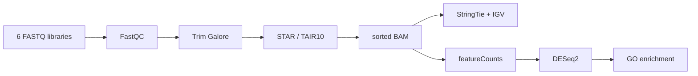

<div align="center">

<h1>From reads to regulation</h1>

<p><strong>An end-to-end RNA-seq analysis of iron-deficiency responses in <em>Arabidopsis thaliana</em></strong></p>

[](https://github.com/Ci-yo/BIO211_CW2_RNAseq/actions/workflows/archive-check.yml)


<sub>FastQC profiles before and after evidence-based read trimming.</sub>

</div>

## The project in one minute

This repository turns a compact six-library teaching dataset into a reproducible RNA-seq case study. Three control libraries (`C1-C3`) are compared with three iron-deficiency libraries (`T1-T3`) to trace the analysis from read quality to biological interpretation.

The practical subset is linked to GEO series [GSE163190](https://www.ncbi.nlm.nih.gov/geo/query/acc.cgi?acc=GSE163190) and the study [Interdependent iron and phosphorus availability controls photosynthesis through retrograde signaling](https://doi.org/10.1038/s41467-021-27548-2). The analysis uses the TAIR10 reference genome and combines FastQC, Trim Galore, STAR, StringTie, featureCounts, DESeq2, IGV and GO enrichment.

## Results at a glance

| Evidence layer | Result | Interpretation |
|---|---:|---|
| Read depth | ~753k reads/library | Compact coursework subset with balanced library sizes |
| STAR alignment | 90.76-91.29% uniquely mapped | Consistent mapping across all six samples |
| Total mapping | 98.65-99.00% | Data quality supports downstream quantification |
| Differential expression | 453 genes at FDR < 0.05 | 227 up-regulated, 226 down-regulated |
| GO input set | 189 genes | 137 up and 52 down at `padj < 0.01`, `\|log2FC\| >= 1` |
| Functional signal | stress up, photosynthesis down | Coherent response to iron limitation |

## A visual tour of the evidence

<table>
  <tr>
    <td width="50%" align="center">
      <br>
      <strong>Expected assembly</strong><br>
      StringTie follows the annotated structure at <code>AT1G67090</code>.
    </td>
    <td width="50%" align="center">
      <br>
      <strong>Alternative structure</strong><br>
      A candidate 3' extension appears at <code>AT2G04790</code>.
    </td>
  </tr>
  <tr>
    <td width="50%" align="center">
      <br>
      <strong>Differential expression</strong><br>
      Treatment-responsive genes separate by effect size and FDR.
    </td>
    <td width="50%" align="center">
      <br>
      <strong>Functional interpretation</strong><br>
      Photosynthesis and electron-transport terms dominate the down-regulated set.
    </td>
  </tr>
</table>

## Analysis path



Every stage leaves a compact, inspectable output in the repository. The full raw and intermediate files are intentionally kept outside Git.

## Repository guide

```text
BIO211_CW2_RNAseq/
|-- README.md                    visual project overview
|-- environment.yml             Conda/Bioconda environment
|-- .github/workflows/           automatic archive checks
|-- docs/
|   |-- analysis-notes.md        methods, results and interpretation
|   `-- coursework-context.md    original project scope, paraphrased
|-- scripts/
|   |-- 01_qc_alignment.sh
|   |-- 02_transcript_assembly.sh
|   |-- 03_differential_expression.R
|   |-- 04_go_enrichment.R
|   `-- validate_archive.py      dependency-free result audit
|-- data/
|   |-- processed/               alignment and counting summaries
|   `-- results/                 DESeq2 tables and gene sets
|-- figures/
|   |-- qc/
|   |-- assembly/
|   `-- differential-expression/
`-- references/                  dataset and method citations
```

## Reproduce the workflow

```bash
conda env create -f environment.yml
conda activate bio211-rnaseq
```

Place `C1.fastq` ... `T3.fastq` in `data/raw/`, then place `TAIR10.toplevel.fa`, `TAIR10.gtf` and `TAIR10.chrom.sizes` in `reference/`.

```bash
bash scripts/01_qc_alignment.sh
bash scripts/02_transcript_assembly.sh C1
Rscript scripts/03_differential_expression.R
Rscript scripts/04_go_enrichment.R
```

For a quick integrity check that requires only Python:

```bash
python scripts/validate_archive.py
```

The same validation runs automatically on every push and pull request through GitHub Actions.

## Data philosophy

The original working folder was approximately 2.31 GB. It included a 977 MB archive, BAM/TDF tracks, duplicated reference FASTA/GTF files, FastQC archives, R workspace state and several draft runs. This repository keeps the scientifically useful core: portable code, compact processed tables, complete DESeq2 output, key gene lists and representative figures.

Raw reads and large reproducible intermediates are excluded through `.gitignore`. See [data/README.md](data/README.md) for the exact inclusion policy.

## One result that deserves caution

The original write-up described `STRG.2006.1` as a novel transcript. The retained IGV image overlaps annotated `AT1G43170` models, so this archive calls it a **candidate novel isoform**. A defensible novelty claim requires strand-aware `gffcompare` class codes and reproducible splice support across replicates. That validation step is included in the transcript-assembly script.

## Explore further

- [Analysis notes](docs/analysis-notes.md) - the complete biological and technical interpretation
- [Project context](docs/coursework-context.md) - what the original coursework asked the analysis to demonstrate
- [References](references/references.md) - dataset, aligner, quantification and statistical-method sources

> **Academic-use note**
>
> This is an archive of completed coursework and a reproducibility example. If you are taking a similar course, follow your institution's academic-integrity rules and do not submit this work as your own.
