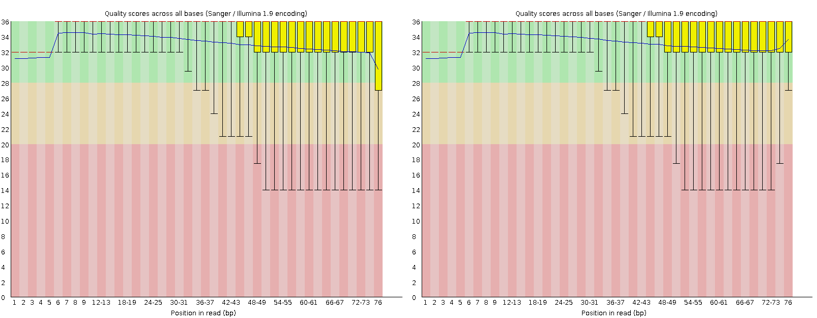
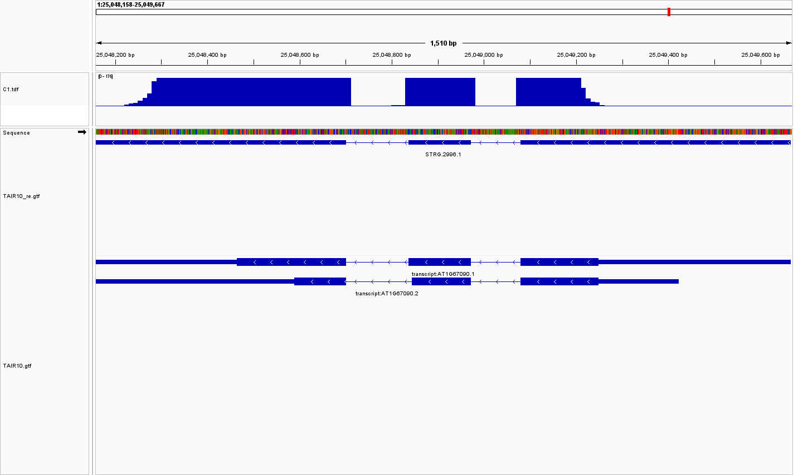
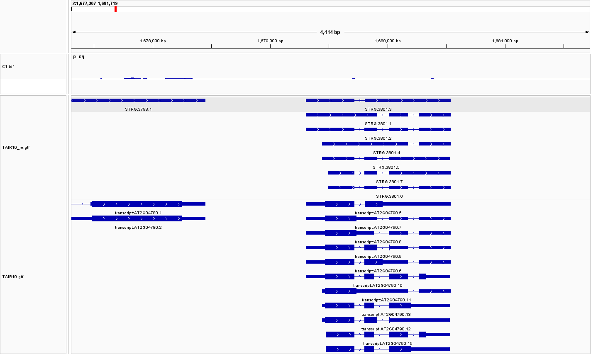
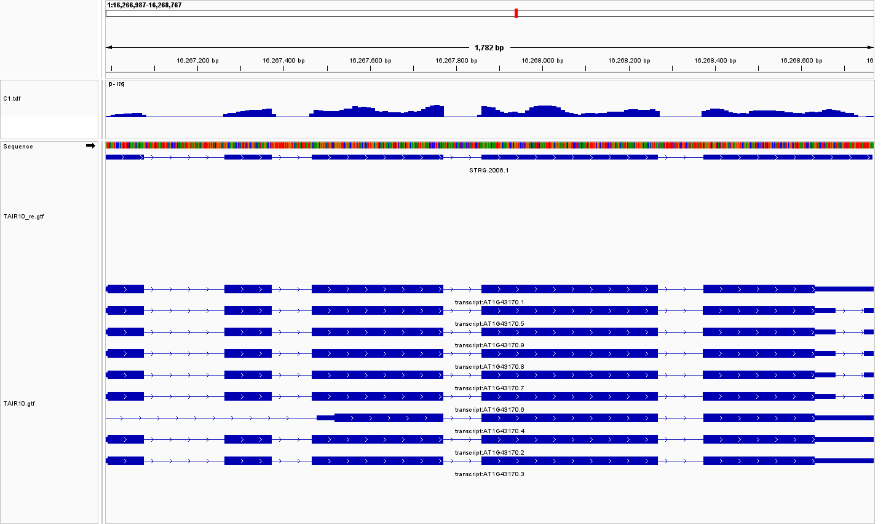
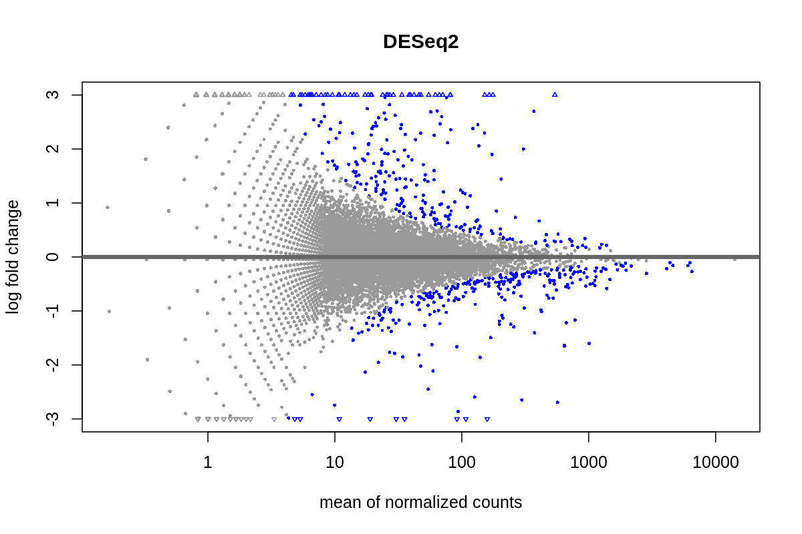
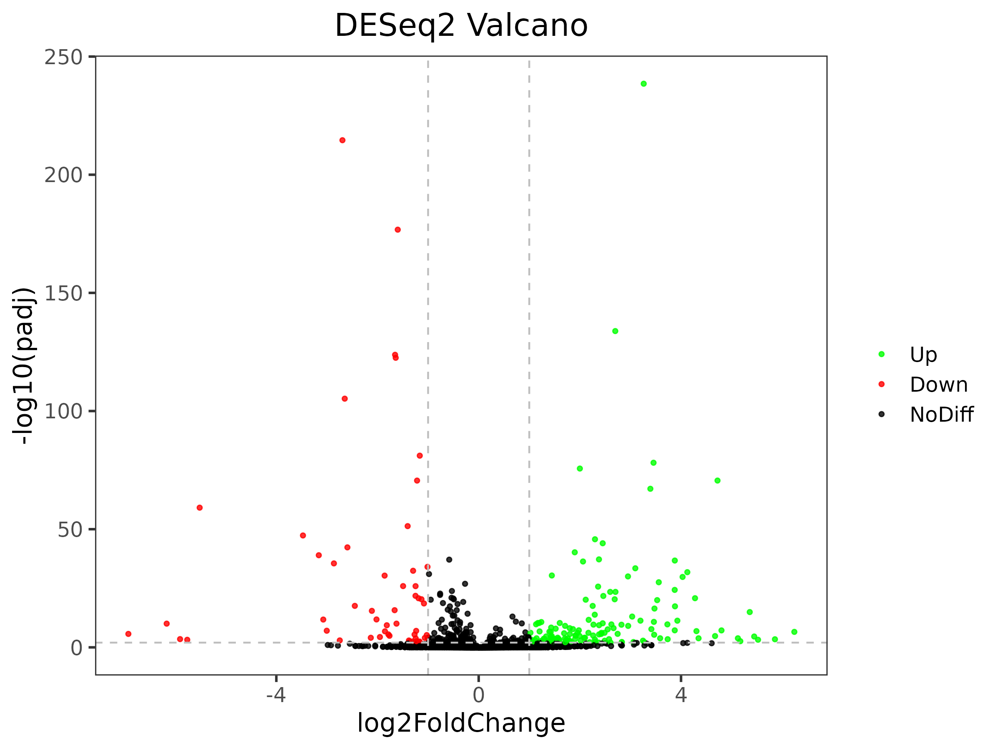
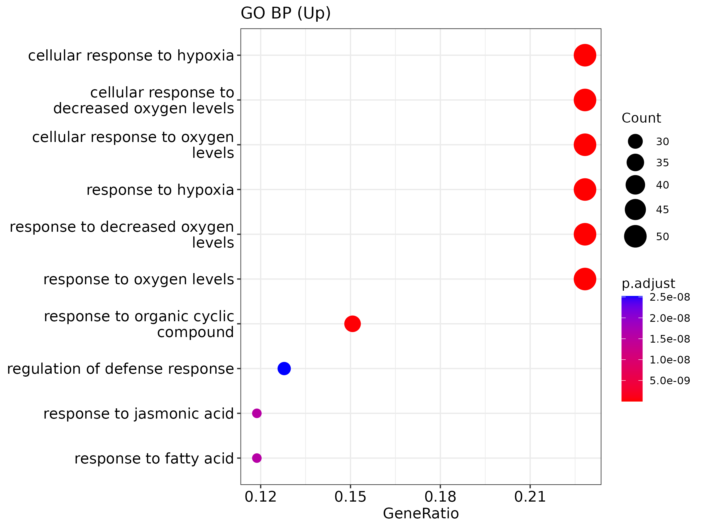
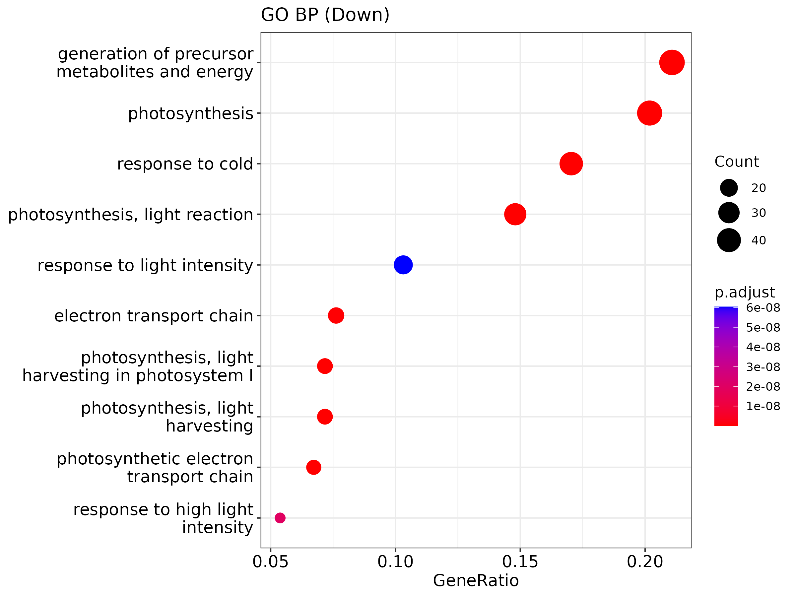

# Analysis notes

This document records the methods, observations and interpretation behind the visual overview in the repository README.

## Dataset, quality control and alignment

### Dataset and biological question

This coursework used a six-library subset of an *Arabidopsis thaliana* RNA-seq study associated with GSE163190. The original experiment examined how iron (Fe) and phosphate (P) availability jointly influence photosynthesis. Seven-day-old Col-0 seedlings were transferred to nutrient treatments and shoot transcriptomes were measured over time. The practical subset compares three control libraries (`C1-C3`) with three Fe-deficiency libraries (`T1-T3`) and uses TAIR10 for alignment and annotation.

Iron is required for photosynthetic electron transport and chlorophyll-related processes. Iron deficiency can cause chlorosis, while phosphorus availability modifies the response. Comparing the two conditions therefore tests how nutrient limitation changes nuclear gene-expression programmes related to photosynthesis and stress.

### QC and trimming

Each library contained 752,993-753,021 reads. FastQC showed generally acceptable per-base quality and negligible adapter signal. The expected 5' composition bias and occasional over-represented-sequence warnings were retained as diagnostics rather than treated automatically as failures. Trim Galore was run at Q20 with a minimum retained length of 20 bp. Only a small fraction of bases and reads was removed; the trimmed read-length distribution broadened from a peak at 76 bp to approximately 72-76 bp.

### STAR alignment

Trimmed reads were aligned to TAIR10 with STAR. Unique mapping ranged from 90.76% to 91.29%, while total mapping ranged from 98.65% to 99.00%. Most unmapped reads were classified as too short (0.96-1.31%); the reported mismatch fraction rounded to 0.00%.

| Sample | Input reads | Unique mapped | Multi-mapped | Total mapped |
|---|---:|---:|---:|---:|
| C1 | 753,006 | 91.08% | 7.92% | 99.00% |
| C2 | 752,993 | 91.00% | 7.87% | 98.87% |
| C3 | 753,014 | 90.76% | 7.89% | 98.65% |
| T1 | 753,021 | 91.29% | 7.58% | 98.87% |
| T2 | 753,009 | 90.98% | 7.67% | 98.65% |
| T3 | 753,014 | 91.04% | 7.63% | 98.67% |

These consistent rates support downstream quantification. The compact practical subset is useful for teaching, but its shallow read count limits discovery of low-abundance isoforms.

## Reference-guided transcript reconstruction

StringTie was run on sample C1 using `TAIR10.gtf` as a guide, and reconstructed models were inspected against TAIR10 in IGV.

### Expected reconstruction

At `AT1G67090` (`chr1:25,048,158-25,049,667`), the reconstructed model reproduced the main annotated exon-intron structure and its splice junctions aligned with coverage peaks. This is an example of reference-guided assembly behaving as expected.

### Model differing from the annotation

At `AT2G04790`, StringTie produced several isoforms with a terminal region extending beyond selected TAIR10 models. Continuous local coverage provides evidence for an alternative 3' boundary or UTR extension, although exact boundaries should be confirmed with replicate-aware transcript comparison and, ideally, longer reads.

### Candidate novel isoform

`STRG.2006.1` was originally reported as novel near `chr1:16,266,987-16,268,767`. The archived IGV view, however, also shows TAIR10 models for `AT1G43170` in the same interval. It is therefore safer to describe this as a **candidate novel isoform or transcript structure**, not a validated novel gene. A robust novelty call should compare the assembled GTF to TAIR10 with `gffcompare`, check strand and transcript class codes, and require reproducible splice support across biological replicates.

## Differential expression and GO enrichment

### DESeq2 analysis

Gene-level counts were generated with featureCounts and analysed using a DESeq2 negative-binomial model with condition as the design factor. Benjamini-Hochberg-adjusted p-values controlled the false discovery rate.

At `padj < 0.05`, 453 genes were significant:

- 227 up-regulated in treatment relative to control;
- 226 down-regulated in treatment relative to control.

For GO enrichment, a stricter effect-size filter (`padj < 0.01` and `|log2FC| >= 1`) produced 137 up-regulated and 52 down-regulated genes.

### IGV consistency check

TDF coverage was examined using identical y-axis limits across samples. Representative up-regulated loci showed higher treatment coverage, while representative down-regulated loci showed the opposite direction. This locus-level check does not replace statistical analysis, but it is useful for detecting mapping artefacts or conclusions driven by a single replicate.

### GO interpretation

Up-regulated genes were enriched for responses to oxygen level, hypoxia, defence and jasmonic acid. Down-regulated genes were enriched for photosynthesis, light reactions, light harvesting and electron transport. These results fit the biological expectation that iron limitation suppresses photosynthetic programmes while activating stress responses.

GO enrichment should be read as over-representation relative to the tested-gene background, not as proof that every gene in a pathway changed or that the pathway is causally responsible. Redundant GO terms also describe overlapping gene sets, so related terms should be interpreted as functional themes.

## What RNA-seq reveals about gene regulation

RNA sequencing couples transcript discovery with transcript abundance measurement. A typical experiment begins with RNA extraction and integrity assessment, followed by rRNA depletion or poly(A) selection, fragmentation, reverse transcription, adapter ligation and sequencing. Library choice matters: poly(A) selection efficiently profiles many coding transcripts, whereas rRNA depletion retains non-polyadenylated RNAs and can be more suitable for degraded samples. Strand-specific libraries improve assignment of overlapping and antisense transcription, while paired-end or long reads improve junction and isoform resolution.

The computational workflow begins with read-quality assessment, followed by evidence-based trimming. Splice-aware alignment tools such as STAR map reads across exon junctions. featureCounts can aggregate aligned reads to genes, while transcript-level or quasi-mapping methods are alternatives when isoform abundance is the main target. DESeq2 models counts with negative-binomial distributions and shares information across genes to stabilise dispersion and fold-change estimates. Transformed counts support exploratory PCA and clustering, but statistical testing should use count models rather than treating normalised expression values as ordinary continuous measurements.

At gene level, RNA-seq identifies programmes induced or repressed by a perturbation. Transcript-resolved analysis can reveal exon skipping, alternative splice sites, altered untranslated regions and isoform switching. Reference-guided assembly can also propose unannotated structures, but short reads often cannot resolve full-length isoforms uniquely; candidate novelty therefore needs stringent comparison and validation.

Major risks include confounded experimental designs, batch effects, inadequate biological replication, composition bias, ambiguous mapping among paralogues and low-count instability. These risks are reduced by balanced designs, biological replicates, appropriate normalisation, pre-specified contrasts and visual inspection of representative loci. Sequencing deeper cannot substitute for replication.

Reproducibility requires versioned code, parameters, sample metadata, software versions and appropriate data access. Reference bias remains important in structurally diverse or non-model genomes. In human studies, RNA-seq data can also reveal identifiable genetic variants, creating privacy and governance concerns.

Long-read RNA sequencing is improving full-length isoform discovery, while short reads remain efficient for robust quantification. Hybrid designs can combine both advantages. Single-cell and spatial transcriptomics extend regulatory analysis to cell types and tissue context, but introduce additional challenges such as doublets, ambient RNA, sparsity and over-correction of biological variation.

In this dataset, RNA-seq linked iron deficiency to repression of photosynthesis-related genes and induction of hypoxia/defence programmes. The agreement between DESeq2 direction, GO themes and representative IGV coverage illustrates how statistical, functional and locus-level evidence can be combined to interpret gene regulation.
